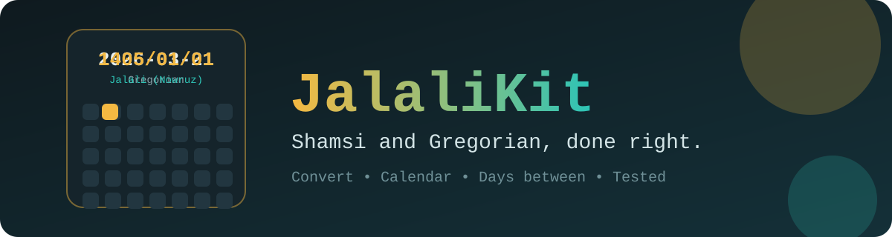

<p align='center'></p>

# JalaliKit 📅

**Shamsi and Gregorian dates, done right.** Convert in both directions, flip through a Jalali calendar and count the days between two dates. 🇮🇷

No accounts, no build step, no dependencies. Everything runs in your browser.

## ✨ What you get

- 🗓️ **Today** in Jalali with Persian digits, weekday and month names, plus a one-click copy of `1405/08/20` style dates
- 🔄 **Gregorian to Jalali** and **Jalali to Gregorian**, with clear errors like "Esfand 1404 has 29 days"
- 🧱 **Month calendar** (Saturday first, Fridays tinted). Click a day to convert it
- ➖ **Days between** two dates, with weeks and the Jalali dates
- 🔢 **Persian digits** and month names in Persian and English
- 🌙 **Dark and light themes**, keyboard friendly, reduced-motion aware

## ✅ Tested

The date math lives in `jalali.js` and has its own tests:

```bash
node jalali.test.js
```

They check known Nowruz dates (1400, 1403, 1404 and 1405), leap years, month lengths, weekdays, and a **round trip over 20,000 consecutive days** from 1990 to 2044. The converter uses the standard 33-year-cycle algorithm and supports Jalali years from -61 to 3177.

## 🚀 Run it

```bash
git clone https://github.com/CyberLoop-dev/jalalikit.git
cd jalalikit
python3 -m http.server 8000   # or just open index.html
```

## 🧭 How it works


## 📁 Project structure

```text
jalalikit/
├── index.html
├── styles.css
├── app.js            # interface
├── jalali.js         # conversion logic, no DOM
├── jalali.test.js    # tests
└── assets/           # logo and README banner
```

## ⚠️ Known limitations

- Uses the arithmetic calendar, which matches the official one for modern years. For far-future dates the official Iranian calendar is set astronomically, so a rare one-day difference is possible.
- Holidays and events are not included.

## 💡 Ideas for later

- Official holidays
- Date arithmetic (add months, add days)
- Afghan month names

## 🤝 Contributing

Issues and pull requests are welcome. Please run the tests first.

## 📄 License

[MIT](LICENSE)
